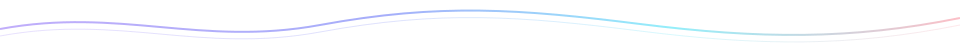

<picture>
  <source media="(prefers-color-scheme: dark)" srcset="./assets/header-dark.svg" />
  
</picture>

I like building things, following curious ideas, and figuring out how they work.

Usually somewhere between a small experiment and one more iteration.

 

### A year in motion

<picture>
  <source media="(prefers-color-scheme: dark)" srcset="https://raw.githubusercontent.com/fumitoshi0524/fumitoshi0524/main/assets/github-snake-dark.svg" />
  
</picture>

 

